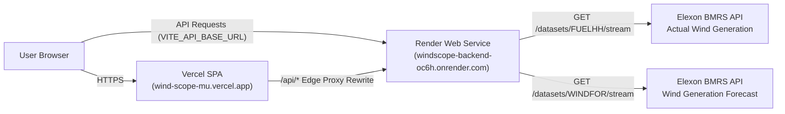

# 💨 WindScope — Wind Generation Intelligence Platform

[](https://wind-scope-mu.vercel.app/)
[](https://windscope-backend-oc6h.onrender.com)
[](https://windscope-backend-oc6h.onrender.com/docs)
[](https://bmrs.elexon.co.uk)
[](https://github.com/jtn11/WindScope)

A high-performance renewable generation intelligence platform engineered for **electricity procurement teams**, **energy trading desks**, and **portfolio managers** in the **Great Britain (GB) electricity market**.

WindScope evaluates day-ahead renewable wind forecasts against physical outturn generation from **Elexon BMRS**, quantifies prediction errors (MAE, RMSE, Bias), models diurnal settlement period profiles, and tracks forecast evolution across multiple daily publication runs for **January 2026**.

---

## 🌐 Live Production Deployments

| Component | Provider | URL | Purpose |
| :--- | :--- | :--- | :--- |
| **Frontend Application** | Vercel | **[https://wind-scope-mu.vercel.app/](https://wind-scope-mu.vercel.app/)** | Interactive trading dashboard, visual analytics, date filters, and CSV export |
| **Backend REST API** | Render | **[https://windscope-backend-oc6h.onrender.com](https://windscope-backend-oc6h.onrender.com)** | Asynchronous FastAPI service running Pandas/NumPy statistical engine |
| **API Documentation** | Swagger UI | **[https://windscope-backend-oc6h.onrender.com/docs](https://windscope-backend-oc6h.onrender.com/docs)** | Interactive OpenAPI test sandbox & endpoint schema reference |
| **Health Check** | Render | **[https://windscope-backend-oc6h.onrender.com/api/health](https://windscope-backend-oc6h.onrender.com/api/health)** | Live Elexon stream dataset connectivity status |

---

## ⚡ Problem & Value Proposition

In GB wholesale electricity markets (e.g., EPEX SPOT and Nord Pool), procurement desks must balance physical positions prior to **Day-Ahead Gate Closure (12:00 D-1)**:
- **Systematic Over-forecasting (Long Position):** Commits procurement teams to purchase excessive renewable volume, risking spilled energy or receiving discount imbalance cash-out prices.
- **Systematic Under-forecasting (Short Position):** Forces desks into the balancing mechanism, exposing portfolios to volatile System Buy Price (SBP) spikes.
- **Publication Lag & Uncertainty:** Forecasts evolve throughout D-1 (`02:30`, `04:30`, `07:30`, `09:30`, `11:30`, `15:30`, `18:30`, `22:30`). Purchasing decisions made at 12:00 D-1 must lock in the most accurate pre-auction publication (`11:30 D-1`).

**WindScope provides the quantitative toolkit and historical audit trail to evaluate forecast reliability and de-risk day-ahead hedging.**

---

## 📡 Live Elexon BMRS Stream API Integration

WindScope integrates directly with real-time streaming datasets from the official **Elexon BMRS API v1**:

| Dataset | Stream Endpoint | Query Parameters | Description |
| :--- | :--- | :--- | :--- |
| **Actual Generation** | `/datasets/FUELHH/stream` | `settlementDateFrom=YYYY-MM-DD`<br>`settlementDateTo=YYYY-MM-DD`<br>`fuelType=WIND` | National-level half-hourly physical wind outturn generation (MW) across 48 settlement periods. |
| **Forecast Generation** | `/datasets/WINDFOR/stream` | `publishDateTimeFrom=...Z`<br>`publishDateTimeTo=...Z` | National wind generation forecasts (MW) with publication timestamps (`publishTime`) and delivery start times (`startTime`). |

### 1. ISO UTC `startTime` Matching Logic
- **Actuals (`FUELHH`):** Delivered on half-hourly settlement periods with ISO UTC `startTime` (`00:00:00Z`, `00:30:00Z`, `01:00:00Z`, etc.).
- **Forecasts (`WINDFOR`):** Issued on hourly delivery intervals (`00:00:00Z`, `01:00:00Z`, etc.).
- **Alignment:** Each half-hour actual is aligned with the active forecast for its delivery hour window using `startTime`. Error is calculated as:
  $$\text{Error}_i = \text{Forecast}_i - \text{Actual}_i \quad (\text{MW})$$

### 2. Purchasing Decision Cutoff (D-1 12:00 Gate Closure)
- GB Day-Ahead energy auctions close at **12:00 PM D-1**.
- WindScope filters all `WINDFOR` publications released on or before the cutoff time (default: **12:00 D-1**, which selects the **11:30 D-1** publication run).
- Users can switch between standard market cutoffs (`10:00`, `12:00`, `15:00`, `18:00`) or select individual publication runs.

### 3. Forecast Evolution & Publication History
- Analyzes how wind forecasts converge or diverge across all D-1 and intraday publication runs for any selected January 2026 delivery date.
- Tracks progressive MAE, RMSE, and bias across publish runs (`02:30` through `22:30`).

---

## 📊 Quantitative Metrics & Formulas

All statistical operations are computed dynamically using vectorized **Pandas** and **NumPy**:

### 1. Mean Absolute Error (MAE)
$$\text{MAE} = \frac{1}{N} \sum_{i=1}^{N} |\text{Forecast}_i - \text{Actual}_i|$$
Measures average magnitude of forecast deviation in megawatts (MW).

### 2. Root Mean Squared Error (RMSE)
$$\text{RMSE} = \sqrt{\frac{1}{N} \sum_{i=1}^{N} (\text{Forecast}_i - \text{Actual}_i)^2}$$
Penalizes severe outlier errors heavily to highlight extreme market volatility risks.

### 3. Mean Bias Error (MBE)
$$\text{MBE} = \frac{1}{N} \sum_{i=1}^{N} (\text{Forecast}_i - \text{Actual}_i)$$
Quantifies systematic portfolio exposure:
- **Positive Bias (+):** Over-forecasting tendency (portfolio risks being systematically long).
- **Negative Bias (-):** Under-forecasting tendency (portfolio risks being systematically short).

### 4. Median Percentage Error (Median MAPE)
$$\text{MAPE} = \text{Median} \left( \frac{|\text{Forecast}_i - \text{Actual}_i|}{\text{Actual}_i} \right) \times 100\%$$
Evaluates relative forecast error, robustly filtered against near-zero generation periods.

### 5. Normalized MAE (nMAE)
$$\text{nMAE} = \left( \frac{\text{MAE}}{\text{GB Fleet Capacity (30,500 MW)}} \right) \times 100\%$$

### 6. Procurement Reliability Score (0–100) & Grade
$$\text{Score} = 100 - (\text{nMAE} \times 3.8) - \left( \frac{|\text{MBE}|}{\text{Capacity}} \times 40 \right)$$
- **Grade A (88–100):** High reliability, optimal for day-ahead baseload procurement.
- **Grade B (75–87):** Moderate reliability, recommend 5–10% intraday reserve buffer.
- **Grade C (60–74):** Elevated volatility, active intraday balancing advised.
- **Grade D (< 60):** Severe mismatch risk, hedge with flexible dispatch assets.

> [!NOTE]
> **Data Integrity:** In accordance with official Elexon BMRS specifications, `FUELHH` provides aggregate national-level wind outturn generation. Unsupported speculative metrics (such as cash-out financial penalties or unmetered offshore/onshore splits) have been omitted in favor of verified physical metrics.

---

## 🛠️ Technology Stack

| Layer | Technology | Purpose |
| :--- | :--- | :--- |
| **Frontend** | React 18 + Vite | High-performance reactive trading interface |
| **Styling** | Tailwind CSS | Sleek dark-mode energy-trading UI aesthetic |
| **Visualizations** | Recharts | Multi-series curves, histograms, scatter plots, and history heatmaps |
| **Icons** | Lucide React | Modern, accessible iconography |
| **Backend** | Python 3.11+ / FastAPI | Asynchronous REST API service |
| **Analytics Engine**| Pandas + NumPy | High-speed vectorized statistical processing |
| **HTTP Client** | HTTPX | Asynchronous HTTP client for Elexon BMRS stream endpoints |
| **Data Validation** | Pydantic (v2) | Strict schema validation and serialization |
| **Testing** | Pytest + Pytest-Asyncio | Automated backend unit and integration test suite (13/13 passing) |
| **Containerization**| Docker + Docker Compose | One-command multi-container environment |
| **Cloud Hosting** | Vercel (Frontend) + Render (Backend) | Production decoupled cloud deployment |

---

## 📁 Project Structure

```
WindScope/
│
├── frontend/
│   ├── public/
│   ├── src/
│   │   ├── components/
│   │   │   ├── layout/
│   │   │   │   ├── Header.jsx                      # January 2026 status, UTC clock, active range
│   │   │   │   ├── Sidebar.jsx                     # Navigation menu & GB market specs
│   │   │   │   └── Layout.jsx                      # Responsive dark shell layout
│   │   │   ├── charts/
│   │   │   │   ├── GenerationForecastChart.jsx      # Forecast vs actual generation time-series
│   │   │   │   ├── ForecastPublicationHistoryChart.jsx # Multi-publish evolution across D-1 runs
│   │   │   │   ├── ErrorDistributionChart.jsx       # Error histogram with P10 / P50 / P90
│   │   │   │   ├── SettlementPeriodErrorChart.jsx   # 48-period diurnal error profile
│   │   │   │   └── CorrelationScatterChart.jsx      # Parity scatter plot with 45° line
│   │   │   ├── cards/
│   │   │   │   ├── MetricCard.jsx                   # Reusable KPI card (MAE, RMSE, Bias, Peak)
│   │   │   │   ├── ReliabilityScoreCard.jsx         # 0–100 reliability score and Grade A–D
│   │   │   │   └── RampAlertCard.jsx                # Ramp rate detection (>1,200 MW/hr)
│   │   │   └── tables/
│   │   │       ├── SettlementDataTable.jsx          # Settlement period table with CSV export
│   │   │       └── DailyAccuracyTable.jsx           # January multi-day benchmark leaderboard
│   │   ├── pages/
│   │   │   ├── Dashboard.jsx                       # Executive procurement overview
│   │   │   ├── Forecast.jsx                        # Time-series curves & publication history
│   │   │   ├── Accuracy.jsx                        # Error distributions & diurnal profiles
│   │   │   └── Methodology.jsx                     # Market rules, formulas & API docs
│   │   ├── services/
│   │   │   └── api.js                              # API client with VITE_API_BASE_URL normalization
│   │   ├── hooks/
│   │   │   ├── useForecastData.js                  # Time-series state & publication history hook
│   │   │   └── useAccuracyMetrics.js               # Statistical error distribution hook
│   │   ├── utils/
│   │   │   ├── formatters.js                       # MW, GW, dates, and settlement periods
│   │   │   └── cn.js                               # Tailwind class merger
│   │   ├── App.jsx                                 # Routing & global January date filter state
│   │   ├── main.jsx
│   │   └── index.css
│   ├── vite.config.js
│   ├── tailwind.config.js
│   ├── package.json
│   └── Dockerfile
│
├── backend/
│   ├── app/
│   │   ├── main.py                                 # FastAPI application & CORS setup
│   │   ├── api/
│   │   │   └── routes.py                           # REST endpoints for forecast & analytics
│   │   ├── services/
│   │   │   ├── elexon_service.py                   # Elexon FUELHH & WINDFOR stream client
│   │   │   └── analytics_service.py                # Pandas matching & statistical engine
│   │   ├── schemas/
│   │   │   └── forecast.py                         # Pydantic models for responses & metrics
│   │   └── utils/
│   │       └── date_utils.py                       # Settlement period (1–48) conversions
│   ├── tests/
│   │   ├── test_elexon_service.py
│   │   ├── test_analytics_service.py
│   │   ├── test_date_utils.py
│   │   └── test_api_routes.py
│   ├── requirements.txt
│   └── Dockerfile
│
├── vercel.json                                     # Vercel deployment routes & Render edge proxy
├── docker-compose.yml                              # Multi-container orchestration
├── README.md
└── .gitignore
```

---

## ⚙️ Environment Variables

### Frontend Configuration (`frontend/.env` or Vercel Environment Variables)

| Variable | Default Value | Description |
| :--- | :--- | :--- |
| `VITE_API_BASE_URL` | `https://windscope-backend-oc6h.onrender.com` | Base URL of the deployed FastAPI backend. The frontend automatically ensures `/api` is prefixed and strips trailing slashes. |

In local development, if `VITE_API_BASE_URL` is omitted, the Vite dev server automatically proxies relative `/api` requests to `http://localhost:8000`.

---

## 🚀 Quickstart Guide

### Option 1: Run with Docker Compose (Recommended)

To run the entire full-stack application (FastAPI backend + Vite React frontend) with a single command:

```bash
docker-compose up --build
```

- **Frontend Application:** [http://localhost:3000](http://localhost:3000)
- **FastAPI OpenAPI Docs:** [http://localhost:8000/docs](http://localhost:8000/docs)
- **Backend Health Check:** [http://localhost:8000/api/health](http://localhost:8000/api/health)

---

### Option 2: Local Development Setup

#### 1. Backend Setup
```bash
# Navigate to backend directory
cd backend

# Create and activate Python virtual environment
python3 -m venv .venv
source .venv/bin/activate       # On Windows: .venv\Scripts\activate

# Install dependencies
pip install -r requirements.txt

# Start FastAPI server on port 8000
uvicorn app.main:app --host 127.0.0.1 --port 8000 --reload
```

#### 2. Frontend Setup
```bash
# In a new terminal, navigate to frontend directory
cd frontend

# Install npm dependencies
npm install

# Start Vite dev server on port 5173
npm run dev
```

Visit **[http://localhost:5173](http://localhost:5173)** in your browser. The Vite dev server automatically proxies `/api` requests to `http://127.0.0.1:8000`.

---

## 🧪 Running Automated Tests

The backend test suite verifies date utilities, statistical calculations, stream matching, and API routes:

```bash
backend/.venv/bin/pytest backend/tests/ -v
```

Expected test output:
```
backend/tests/test_analytics_service.py::test_match_actual_and_forecast_on_starttime PASSED
backend/tests/test_analytics_service.py::test_calculate_summary_metrics PASSED
backend/tests/test_analytics_service.py::test_filter_forecast_at_cutoff PASSED
backend/tests/test_api_routes.py::test_health_endpoint PASSED
backend/tests/test_api_routes.py::test_forecast_latest_endpoint PASSED
backend/tests/test_api_routes.py::test_publication_history_endpoint PASSED
backend/tests/test_api_routes.py::test_analytics_summary_endpoint PASSED
backend/tests/test_api_routes.py::test_settlement_profile_endpoint PASSED
backend/tests/test_api_routes.py::test_error_distribution_endpoint PASSED
backend/tests/test_date_utils.py::test_get_settlement_period PASSED
backend/tests/test_date_utils.py::test_settlement_period_to_time_range PASSED
backend/tests/test_date_utils.py::test_format_elexon_date PASSED
backend/tests/test_date_utils.py::test_parse_iso_datetime PASSED
======================== 13 passed in 0.43s =========================
```

---

## 🌐 Production Cloud Architecture



### 1. Frontend on Vercel
- **Project Type:** Single Page Application (SPA).
- **Build Command:** `cd frontend && npm install && npm run build`
- **Output Directory:** `frontend/dist`
- **Edge Routing (`vercel.json`):** Proxies any `/api/:path*` request to `https://windscope-backend-oc6h.onrender.com/api/:path*` and rewrites all client-side page routes to `index.html`.

### 2. Backend on Render
- **Service Type:** Web Service (Python 3.11+).
- **Build Command:** `pip install -r backend/requirements.txt`
- **Start Command:** `uvicorn app.main:app --app-dir backend --host 0.0.0.0 --port $PORT`
- **CORS Support:** Configured for `https://wind-scope-mu.vercel.app` and `https://.*\.vercel\.app`.

---

## 🔌 API Endpoints Reference

| Method | Endpoint | Query Parameters | Description |
| :--- | :--- | :--- | :--- |
| `GET` | `/api/health` | None | System status and Elexon dataset connectivity verification. |
| `GET` | `/api/forecast/range` | `start_date=2026-01-01`<br>`end_date=2026-01-07`<br>`cutoff=12:00`<br>`publish_time=` | Time-series actuals (`FUELHH`) matched with forecast (`WINDFOR`) on `startTime`. |
| `GET` | `/api/forecast/latest` | `days=2`<br>`cutoff=12:00` | Latest multi-day forecast and actuals window. |
| `GET` | `/api/forecast/publication-history` | `target_date=2026-01-01` | Forecast curves across all D-1 publication runs (`02:30` to `22:30`) with error progression. |
| `GET` | `/api/analytics/summary` | `start_date=`<br>`end_date=`<br>`cutoff=12:00` | Summary metrics: MAE, RMSE, Mean Bias, Median MAPE, Peak Generation, Reliability Score. |
| `GET` | `/api/analytics/settlement-profile`| `start_date=`<br>`end_date=`<br>`cutoff=12:00` | 48-period diurnal profile showing mean error and standard deviation per settlement period. |
| `GET` | `/api/analytics/error-distribution`| `start_date=`<br>`end_date=`<br>`cutoff=12:00` | Error histogram binned across MW intervals with P10, P50, and P90 quantiles. |
| `GET` | `/api/analytics/daily-accuracy` | `start_date=`<br>`end_date=`<br>`cutoff=12:00` | Multi-day accuracy benchmark leaderboard table for January 2026. |
| `GET` | `/api/analytics/ramps` | `threshold=1200` | Detects rapid generation ramp events (>1,200 MW/hr). |

Interactive OpenAPI documentation is available at `/docs` (Swagger UI) and `/redoc`.

---

## 📄 Settlement Data Export (CSV)

From the **Forecast** page, users can export all filtered half-hourly settlement records to CSV:
- Fields: `settlementDate`, `settlementPeriod`, `startTime`, `forecastMW`, `actualMW`, `errorMW`, `percentageError`, `forecastPublishTime`, `status`.
- Format: RFC 4180 compliant CSV ready for Excel, Python Pandas, or trading desk modeling.

---

## 🛡️ License & Data Attribution

- **License:** MIT License. Developed for energy procurement teams, quantitative analysts, and traders.
- **Data Source:** Elexon BMRS Open Data platform under the UK [Open Government Licence (OGL v3.0)](https://www.nationalarchives.gov.uk/doc/open-government-licence/version/3/).
